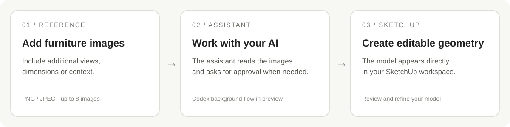

# FurniForge

**Turn furniture reference images into editable SketchUp geometry, with help from your AI assistant.**

FurniForge is an early developer preview for interior designers who want to bring a pictured furniture product into their SketchUp workflow. Add one or more reference images, provide any dimensions or context you know, and let the assistant build a model directly in the open SketchUp scene.

> **Developer preview · Windows · v0.4.2**  
> The current background workflow uses GPT Codex and asks for approval when needed. Model fidelity depends on the reference images and the assistant; hidden details and unknown dimensions may be estimated.

## What you can do

- Add up to eight PNG or JPEG reference images, including multiple views.
- Provide optional product details, dimensions, material notes and a description.
- Start a GPT Codex session from FurniForge and review requested actions as it builds.
- Receive named, editable geometry directly in SketchUp and refine it there.

## Assistant support

| Assistant | Current support |
| --- | --- |
| GPT Codex | Background workflow from the FurniForge panel; tested with a furniture model. |
| Claude Code | MCP setup guide available; manual assistant workflow is unverified. Background launch is not implemented. |
| Cursor | MCP setup guide available; manual assistant workflow is unverified. Background launch is not implemented. |
| Gemini CLI | MCP setup guide available; manual assistant workflow is unverified. Background launch is not implemented. |

The selected assistant requires its own account and access. AI processing uses that provider's applicable allowance or billing. FurniForge does not include an AI subscription.

## Install from the repository ZIP

1. On GitHub, select **Code → Download ZIP**, then extract it to a stable local folder. This repository is currently private, so GitHub access is required.
2. Open that folder as a project in your coding assistant. The assistant needs access to the extracted files on your computer.
3. Ask it: **“Read the FurniForge README and help me install and connect FurniForge for my assistant. Preserve my existing settings and verify the connection to SketchUp.”**
4. Install [FurniForge-0.4.2.rbz](releases/FurniForge-0.4.2.rbz) in SketchUp through **Extension Manager → Install Extension**. Complete any sign-in and permission prompts yourself.
5. Start SketchUp and FurniForge. Follow the assistant-specific setup below, then verify that the bridge responds before starting a model.

**Requirements:** Windows for the tested background launcher, SketchUp with the extension installed, Node.js 20+, and the selected assistant's supported access. The extension package is an unsigned developer preview. Do not move the extracted folder after configuration without updating the launcher paths.

### GPT Codex background setup

From the extracted repository folder, run `npm ci --ignore-scripts`, install and sign in to Codex CLI, then run `setup-launcher.ps1` in PowerShell. If `codex` resolves to a `.cmd` wrapper, provide the native executable with `-CodexPath`. The launcher stores local executable paths in `%LOCALAPPDATA%/FurniForge/launcher.json`; it does not include account credentials. Open **Extensions → FurniForge → Open workspace**, select GPT Codex, attach images, allow the background session, and choose **Create model**. Approve or decline each requested action in the panel.

### Claude Code, Cursor and Gemini CLI

Ask the assistant to read [Assistant setup](integrations/ASSISTANT-SETUP.md). It can help configure that assistant's MCP connection and test `furniforge_status`. This is a manual assistant workflow, not a background session initiated by the FurniForge panel. The integrations have not yet been tested end-to-end with those providers. See the [background integration brief](integrations/BACKGROUND-INTEGRATION.md) for the remaining work.

## Before you use it

- FurniForge is a preview, not a guarantee of a photo-identical or manufacturing-ready model. Hidden surfaces, proportions and material appearance may be approximated; check the result in SketchUp.
- Supplied information takes precedence. If overall dimensions are not provided, scale is approximate. Image analysis, modelling and review can still consume AI usage even when details are supplied.
- Reference files are cached locally and sent to the chosen assistant when it reads them. Request bindings reset when SketchUp closes; save the SketchUp scene and reattach references when needed.
- Commercial activation, texture mapping, and background integrations for Claude Code, Cursor and Gemini are not implemented.

## Documentation

- [Assistant-guided MCP setup](integrations/ASSISTANT-SETUP.md)
- [Background integration development brief](integrations/BACKGROUND-INTEGRATION.md)
- [Technical details and MCP tools](docs/TECHNICAL-DETAILS.md)
- [Test results](TEST-RESULTS.md)
- [Commercial readiness notes](docs/COMMERCIAL-READINESS.md)
- [Third-party notices](THIRD-PARTY-NOTICES.md)

## License and ownership

FurniForge original source and branding are © 2026 **yviero_m**, all rights reserved. See [LICENSE.txt](LICENSE.txt). Third-party components and brand marks have their own terms; their inclusion in this private preview does not establish permission for a public commercial release.
