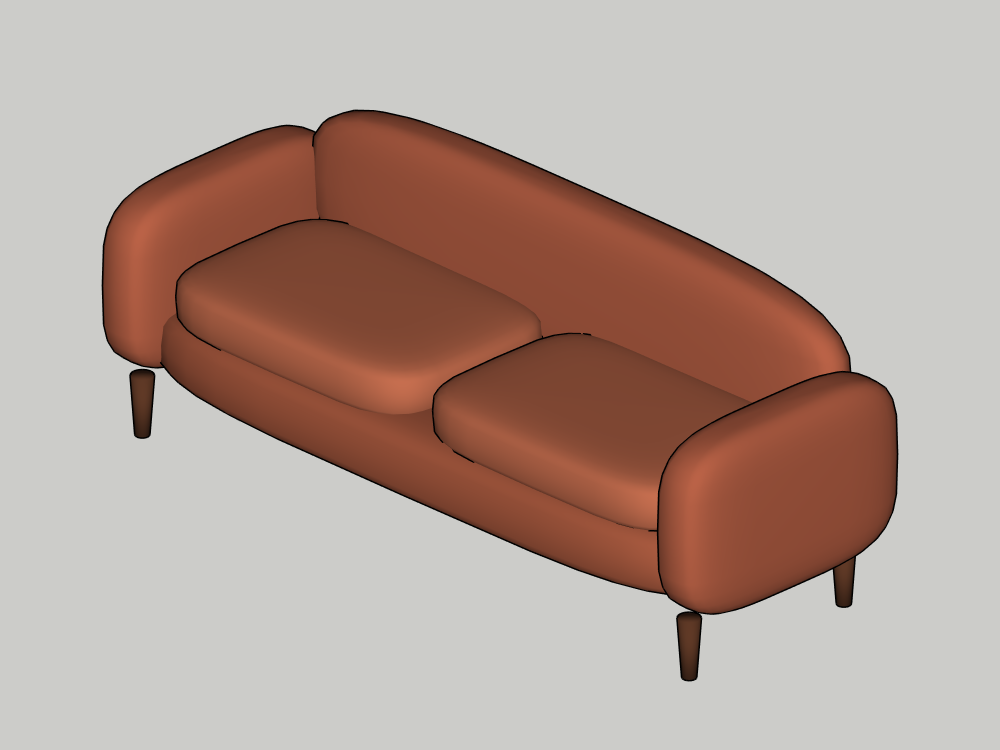

# Original sofa reference and model

This unbranded concept was generated with OpenAI ImageGen as a fictional reference for FurniForge.

The image above is an actual SketchUp preview of the model built with FurniForge MCP from this reference. It contains 10 named parts and 6,016 faces, with no non-solid parts reported. Overall bounds are approximately 2200 × 780 × 820 mm. No dimensions were supplied, so scale and hidden details are inferred. The upholstery uses solid colours rather than fabric textures; similarity is not quantitatively measured. This example does not establish repeatability or manufacturing readiness.

See [test results](../TEST-RESULTS.md) for earlier tests.
