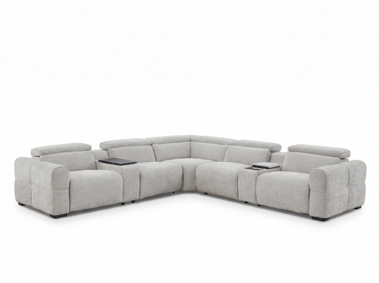
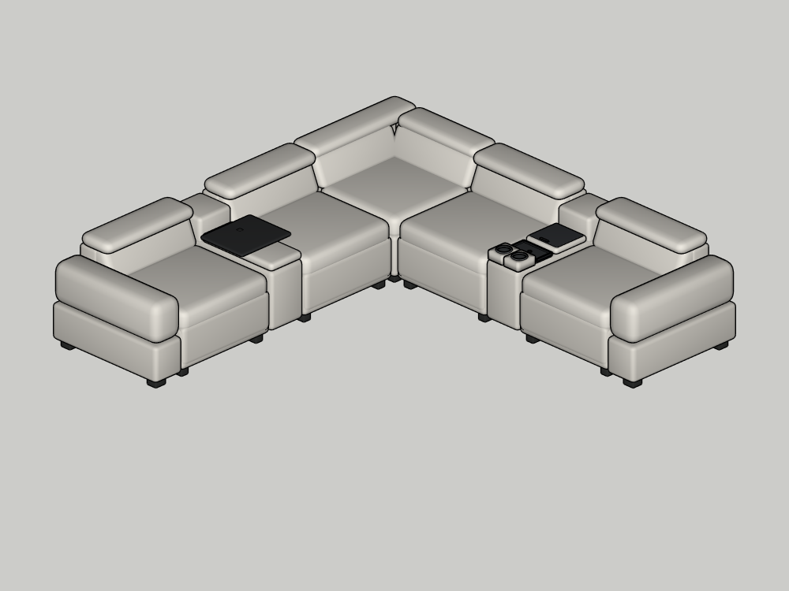
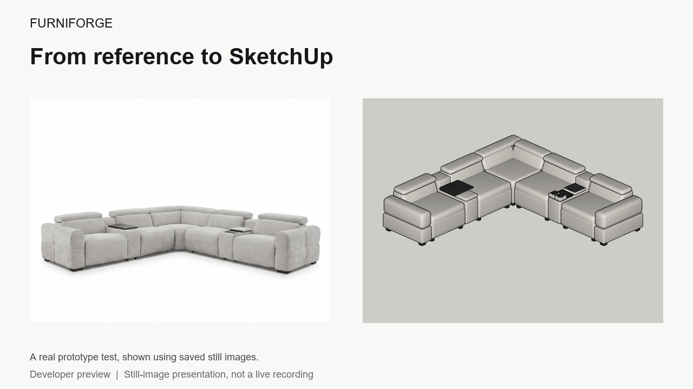

# Reference-to-model test: sofa

This private developer-preview test used six supplied product reference images and an optional description. A GPT Codex background session created geometry in the active SketchUp model after requested tool actions were approved.

*One of six supplied reference images.*

*Actual SketchUp preview from the same test session, revision 12. This is a captured model view, not a recording.*

The test record reports 94 named parts, 45,696 faces and overall bounding dimensions of 3450 × 3450 × 810 mm. The screenshot is a revision preview; the test record does not establish that it is the final revision. Similarity to the reference was not measured. Geometry, upholstery and unseen details are approximations requiring review in SketchUp. See [test results](../TEST-RESULTS.md).

The source and usage rights of the supplied product photograph have not been established. Keep it in the private preview and obtain permission or replace it with an appropriately licensed reference before public or commercial distribution.

## Still-image presentation

This looping presentation uses saved still images. It is not a recording of the modelling session.

## Suggested live demonstration

Record a real 30–60 second SketchUp session showing reference upload, assistant selection and approvals, followed by the actual model in the workspace. Identify cuts or time compression clearly and describe the result as a developer preview. No recording of this particular session was located.
